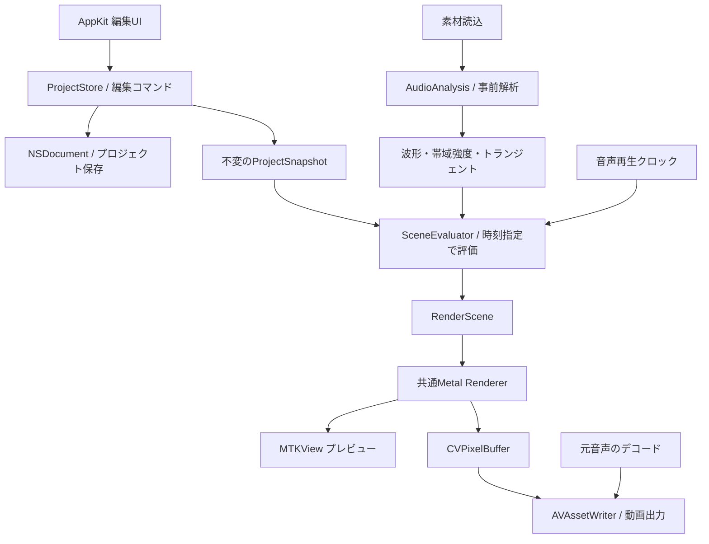

# MV制作ツール 実装設計

作成日: 2026-11-08。要件に基づく段階的な実装設計。以下の初期値・機能範囲は設計上の提案で、ユーザーが指定した確定条件とは区別する。

## 現在のシンプル版

画像1枚・音声1本、手動BPM/開始位置、拡大パルス、32帯域表示、プレビュー/シーク、720p/30fpsの音声付きMP4出力を実装。最低macOS 14、Swift Package executableとして構成する。小規模な最初の実装はCore Graphicsの共通描画とAVAudioPlayerを採用し、AVAssetWriterで一時映像を生成後、AVMutableComposition/AVAssetExportSessionで音声を結合する。解析は音源のサンプルレートのまま2048点DFT、30回/秒で実行し、32帯域をメモリに保持する。音声と同じフォルダの `<音声ファイル名>.mvproject` へ素材参照と設定をJSON形式で自動保存し、最後に保存したプロジェクトを起動時に復元する。同一フォルダの素材は相対参照、他フォルダの画像は絶対参照とする。永続キャッシュ、素材同梱パッケージ、複数画像、トランジェント検出、Metal化は未実装。歌詞一覧の区間編集と全歌詞共通の縁取り色/太さも実装済み。Core Textによる描画をプレビュー/出力で共有し、version 2のJSONへ歌詞と縁取りを保存する。以下は将来拡張を含む目標設計であり、現実装の機能一覧ではない。

## 1. 目的と初期スコープ

Swift＋AppKitのmacOSアプリとして、画像と音声からMVを制作する。音楽のトランジェント・拍による画像アニメーションと、周波数帯域に反応するビジュアライザーを中核にする。

最初の完成形は「音声1本と複数の画像を読み込み、拍に合わせた動きと棒状スペクトラムを追加し、音声付きMP4を書き出せる」ものとする。

| 項目 | 初期実装の提案 |
| --- | --- |
| 環境 | Swift 6、AppKit、XcodeのmacOS Appターゲット。最低macOSは着手時にSDK/API availabilityと対象端末を照合して決定 |
| 入力 | PNG/JPEG、WAV/AIFF/M4A/MP3。実際のデコード可否を読込時に検証 |
| 音声 | 1本、プロジェクト先頭から再生。音声の長さを作品の長さとする |
| 画像 | 複数レイヤー、表示区間、位置・サイズ・回転・透明度 |
| 同期 | 手動BPM＋拍の開始位置、トランジェント検出・編集 |
| 自動化 | 拍またはトランジェントで拡大パルス、任意帯域の強さで連続変調 |
| 可視化 | 棒状、初期32帯域、プリセットから追加 |
| 出力 | 1920×1080、30fps、SDR、MP4/H.264＋AAC。ビットレートは品質プリセットで設定 |
| 保存 | 素材を同梱するプロジェクトパッケージ、Undo/Redo |

テンポ変化の自動追従、複数音声のミックス、音声加工用EQ、動画素材の編集、HDR、プラグイン機構は初期スコープに含めない。EQ風の表示は音の可視化として実装し、音声自体は加工しない。

## 2. 全体構成



| モジュール | 責務 | 依存ルール |
| --- | --- | --- |
| ProjectCore | モデル、時間、編集コマンド、値の検証 | AppKit・Metalに依存しない |
| AudioAnalysis | PCM化、波形、FFT、帯域強度、オンセット検出、解析キャッシュ | UIや描画を知らない |
| Animation | 拍イベント生成、アニメーション評価、パラメータ合成 | ProjectCoreと読取専用解析データに依存 |
| Rendering | RenderSceneをMetalで描画、画像テクスチャ管理 | UIの編集状態を直接参照しない |
| MediaIO | 素材読込、再生、書き出し | 共通評価・描画を利用 |
| App | NSDocument、ウィンドウ、タイムライン、インスペクター | 各モジュールを組み立てる |

最初は1アプリターゲットとローカルSwift Package内の上記ターゲットで構成する。過度なサービス分割や全処理のprotocol化はせず、テスト差し替えが必要なデコード・時計・書込の境界を抽象化する。

## 3. 編集UIとユーザー操作

直近のタイムライン導入は [歌詞テロップ用タイムライン設計](TIMELINE.md) に従う。まず歌詞1トラックのテキストクリップを扱い、現行のJSON自動保存とCore Graphics描画へ接続する。以下の複数レイヤーUIはその後の目標構成。

- 左: 素材一覧とレイヤー一覧。画像とビジュアライザーを追加・並べ替え。
- 中央: プレビュー、再生/停止、現在時刻。画像の移動・拡大縮小。
- 下: 音声波形、拍・トランジェントのマーカー、レイヤー表示区間、再生ヘッド。
- 右: 選択対象の見た目・音楽連動設定。ビジュアライザーはプリセット、色、帯域数、感度、滑らかさ、配置。

AppKitのNSSplitViewControllerを骨格とし、一覧はNSOutlineView/NSTableView、プレビューはMTKView、タイムラインは可視範囲のみ描くカスタムNSViewを使う。波形は階層化したmin/maxデータを使用する。

基本フロー: 音声読込 → 解析進捗表示 → 画像追加 → BPM/拍開始位置を設定またはトランジェントを選択 → 「拍でパルス」を追加 → 「スペクトラム」を追加 → プレビュー → 保存/書き出し。

プリセットは通常のレイヤーと設定を生成する。追加後も個別編集でき、プリセット専用の別レンダリング経路は作らない。

## 4. プロジェクトモデル

主要な値型はCodable、安定したIDを持たせる。GPUリソース・再生状態・選択状態は保存モデルから分離する。

| 型 | 主な内容 |
| --- | --- |
| Project | schemaVersion、canvas、audioAssetID、duration、layers、timingTracks |
| Asset | ID、種類、パッケージ内相対パス、内容ハッシュ、デコード後メタデータ |
| Layer | ID、表示名、表示区間、重なり順、基本Transform、content、animations |
| LayerContent | image(assetID) / spectrum(SpectrumStyle)。関連値付きenum |
| TimingTrack | 手動拍グリッド、編集済みトランジェント列、将来の明示的拍列 |
| BeatGrid | BPM、基準拍の時刻、拍子。初期版は曲中一定BPM |
| TransientEvent | ID、時刻、強度。自動検出結果とユーザー編集済み結果は別管理 |
| AnimationBinding | 対象プロパティ、入力、範囲、エンベロープ、合成規則 |
| AnalysisDescriptor | 素材ハッシュ、解析バージョン、サンプルレート、FFT設定、キャッシュ参照 |

時間は永続化用の有理数型（Int64 value / Int32 timescale）を定義し、AVFoundation境界でCMTimeに変換する。音声解析はサンプル位置とサンプルレートも保持。フレーム番号から時刻を直接算出し、浮動小数点の加算による累積ずれを避ける。レイヤー区間は開始を含み終了を含まない。

キャンバス座標は中央原点、右を+x、上を+y。位置と画像の表示サイズはキャンバス寸法に対する正規化値とし、回転はラジアン。画像はアスペクト比を保持し、Metal出力側で座標系を変換する。

## 5. 音声解析

### 事前解析とキャッシュ

音声をバックグラウンドでPCMにデコードし、チャンク単位で解析する。曲全体のPCMをメモリに常駐させない。解析用は48kHzに揃え、音声出力は別経路で元音声から作る。各チャンネルのパワーを合成して解析し、逆相ステレオの単純加算による相殺を避ける。

処理パイプライン:

1. 長さ・チャンネル・デコード可否を検証。
2. 波形表示用のmin/maxとRMSを生成。
3. Hann窓、FFT 2048サンプル、hop 512を初期候補としてスペクトルを計算。
4. チャンネル平均パワーを基に、20Hz〜min(20kHz, Nyquist)の対数帯域へ集約。初期内部データは128帯域。
5. 正のスペクトル変化量からオンセット候補を計算し、局所閾値・ピーク選択・最小イベント間隔でトランジェントを抽出。
6. スペクトル・イベント・波形・解析設定をキャッシュへ保存。

FFTはAccelerate/vDSPを用いる。値は調整可能な初期候補であり、低音の分解能、密な打音、静かな曲を含む素材で評価する。窓の中心を時刻として記録し、先頭/末尾のゼロ埋めとデコード起点を揃える。窓長に由来する時間誤差も検証する。

帯域表示はパワーの積算 → 基準を固定したdB変換 → 表示レンジ（初期候補−80〜0dB）で正規化 → 感度調整 → attack/release平滑化。無音では有限の0となるよう下限を設ける。表示帯域数は内部帯域の範囲で再集約し、変更でFFTをやり直さない。より細かい帯域が必要な仕様は再解析対象とする。

平滑化データは解析時刻順に事前計算し、設定変更時は派生キャッシュを再生成する。任意時刻では補間して参照し、シーク経路や描画fpsで見た目が変化しないようにする。初期128帯域をFloat32で約94回/秒保存すると5分で約14.4MB。長い曲は分割キャッシュと可視区間の読込で対応する。

キャッシュキーは素材内容ハッシュ＋解析アルゴリズムのバージョン＋設定。表示色や画像変更では解析を再実行しない。解析結果の更新は全体が揃ってから差し替え、キャンセル・古いジョブの結果を現在の素材へ適用しない。

### 拍とトランジェントの扱い

拍とトランジェントは別のタイミングトラックとして扱う。打音のない拍や裏拍もあるため、検出したトランジェントをそのまま拍としない。

初期版の拍はBPM、開始位置、拍子から生成する。タップテンポと波形上での基準拍移動を用意する。トランジェントは自動検出後に追加・削除・移動できる。再解析で手動編集結果を上書きせず、適用操作で置き換える。

次段階でオンセット包絡の自己相関等によるBPM候補推定、位相探索、候補選択UIを追加する。倍/半テンポの誤りを想定し手動補正を残す。テンポ変化は将来、明示的な拍時刻列で扱えるモデルにしておくが、初期UIには実装しない。

## 6. アニメーション評価

SceneEvaluatorはProjectSnapshot、読取専用AudioFeatures、時刻tを受け、描画用RenderSceneを返す。再生のたびにキーフレームを大量生成する方式は採らず、ルールを時刻から評価する。

入力は2系統とする。

- イベント入力: 毎拍、n拍ごと、トランジェント。attack/hold/releaseと強度から一時的な変化量を作る。
- 連続入力: 選択帯域の強さ。感度と出力範囲を指定して拡大率・透明度などへ対応付ける。

例: 「毎拍、scaleに+0.08、attack 20ms/release 180ms」「40〜160Hzの強さでscaleを1.0〜1.15」「4拍ごとに次の画像へ切替」。画像切替は第2段階で、イベント番号から表示画像を決める専用シーケンスとして追加する。

イベントが重なるときは初期版では直近イベントによる再トリガーとする。加算蓄積しない。複数bindingは同一プロパティに対する変化量を加算し、scaleは正値、opacityは0〜1に制限する。単位と合成順を明文化してテストする。画像レイヤー全体の変形を先に求め、その後に重なり順で合成する。

CAAnimationを動画表現の正本にしない。AppKitの操作用アニメーションには利用できるが、作品の動きは共通評価器が決定する。

## 7. 描画と再生

画像と棒状スペクトラムを同じMetalの2D合成器で描く。RenderSceneは画像quadと棒のinstance群、色、変換行列、クリップ領域など、描画に必要な情報だけを保持する。

画像は読込時に向きと色空間を正規化し、テクスチャをキャッシュする。半透明はpremultiplied alphaで統一。作業色空間と出力の変換を明示し、初期SDR出力はRec.709とする。プレビュー表示変換と書出しタグを揃える。色・ガンマ・上下反転は実画像と書出し再読込で検証する。

プレビューはMTKViewへ、書出しはオフスクリーンのMetalテクスチャへ描く。MetalとCore Videoを連携し、エンコーダへ渡すCVPixelBufferに描画する。GPU完了前のバッファをエンコーダへ渡さず、利用中バッファを再使用しない。キューは少数フレームに制限する。

音声再生はAVAudioEngine＋AVAudioPlayerNodeを使用し、プレイヤーのサンプル時刻を編集タイムラインへ変換する。UIタイマーの経過秒数を作品時刻にしない。開始・停止・シーク・出力デバイス変更時に再同期し、出力レイテンシを考慮して画面と音を合わせる。停止中のシークは指定時刻を直接評価する。

プレビューが重い場合は描画フレームを間引き、必要なら低解像度にする。時間は音声へ追従させ、書出しでは全フレームを生成する。

## 8. 書き出し

1. 書出し開始時のプロジェクトと解析設定を不変snapshotに固定する。
2. 必要な解析と素材が揃っていることを確認し、出力設定・容量・保存先を検証。
3. プロジェクト長D、fps Fについてceil(D×F)フレームを生成。時刻はn/Fで算出し、コンテナの終了をDに設定して最後のフレーム区間を調整する。
4. 共通SceneEvaluatorとRendererでフレームを生成し、AVAssetWriterの映像入力へ渡す。
5. 元音声をAVAssetReader等でPCMへデコードし、タイムライン0起点・Dまでの音声をAAC入力へ渡す。解析用モノラル値から音声を作らない。
6. 音声・映像の入力はそれぞれバックプレッシャーに従って進め、一方の完了を待ってもう一方を開始する構造にしない。
7. 両入力とGPU処理の完了後にwriterを確定し、一時ファイルから指定先へ移動する。

AVFoundationの書込APIは採用SDKと最低OSに合わせて固定する。現行ドキュメントには非同期PixelBufferReceiverがあるため、実装着手時に利用可能性を確認して採用する。古いadaptorと新しいreceiverを両方実装する互換層は作らない。

キャンセル時は解析/描画/書込タスクを停止し、一時出力を削除する。失敗時は素材、解析、GPU、エンコード、保存先のどこで失敗したかをUIに表示する。進捗は処理済み映像時刻と音声処理状態を基にし、完了表示はwriter確定後とする。

## 9. 保存・並行処理・編集履歴

NSDocumentで保存、変更状態、Undo/Redoを統合する。プロジェクトはファイルパッケージとして次を保持する。

```text
Project.mvproject/
  project.json
  Assets/<asset-id>.<extension>
  Analysis/<cache-key>/...
```

初期版は素材をパッケージ内へコピーすることで移動時の参照切れを避ける。巨大素材の外部参照は将来要件とする。解析キャッシュは再生成可能で、欠損・破損時は再解析する。project.jsonには編集意図と設定を保存し、キャッシュの絶対パスは保存しない。保存はNSDocumentの安全な書込手順を利用し、背景ジョブと同じファイルを同時更新しない。

UIとProjectStoreはMainActor、解析・書出しは独立したジョブで実行する。長時間ループにキャンセル確認を入れる。編集操作は型付きコマンドとし、ドラッグ中の多数の変更を1回のUndoにまとめる。解析キャッシュ更新はユーザー編集履歴に含めない。

書出し中も編集できるが出力は開始時点の内容に固定。GPUキューとテクスチャの寿命は描画側が所有し、UIやactor境界で非Sendableなメディアオブジェクトを無秩序に共有しない。

## 10. 実装順序と完了条件

| 段階 | 実装 | 完了条件 |
| --- | --- | --- |
| 1: 縦に通す試作 | AppKit骨格、画像1枚、音声1本、共通描画、MP4出力 | 静止画＋音声の10秒出力を再生できる |
| 2: 音楽連動の核 | FFT帯域キャッシュ、棒状ビジュアライザー、BPM/開始位置、拡大パルス | 任意時刻へシークしても同じ見た目、音声付き出力に反映 |
| 3: 編集と保存 | 複数画像、レイヤー区間、インスペクター、プリセット、NSDocument、Undo | 保存後の再読込と素材同梱の移動で作品を再現 |
| 4: トランジェント | 自動検出、感度、イベント手動補正、イベント連動 | クリック音の検出精度・時刻誤差を測定し、補正を保存できる |
| 5: 操作性と品質 | BPM候補推定、画像切替、円形表示、性能調整 | 実曲で制作フローを通し、プロファイル結果に基づき改善 |

各段階の最後に、重複、責務、命名、不要なコードを見直すリファクタリングと必要な再検証を行う。機能を広げる前に音声同期と書出しを成立させる。

## 11. 検証計画

- DSP: 無音、単一サイン波、2帯域の合成音、逆相ステレオ、クリック列。帯域ピーク、正規化、NaNなし、検出誤差を確認。
- 時間評価: 拍境界、開始位置が0でない曲、イベント重複、区間端点、シーク順の変更で結果が一致。
- 描画: 既知時刻の画像とスペクトラムを固定条件で比較。GPUの微小差は許容誤差で判定。
- 書出し: 既知の時刻のクリック音＋発光フレームを再読込し、同期誤差の目標を1出力フレーム以内とする。コンテナ時刻だけでなくデコードした音声も検証。
- 永続化: 保存/再読込でモデル一致、Undo/Redo、キャッシュ削除から再生成、コピー後に元素材なしで開ける。
- 障害: 無効素材、保存先エラー、キャンセル、途中の素材変更、古い解析結果到着。
- 性能: 基準端末を決め、1080p/30fps、画像10レイヤー＋64本の棒、5分曲を計測。メモリ、描画時間、解析時間、出力速度をInstrumentsで記録し、目標を決める。現時点で速度保証はしない。

## 12. 実装前に確定する事項

最低macOS、初期出力仕様、対応入力形式、画像切替を初期版へ含めるかを確定する。まず段階1でMetal→動画出力と音声同期の技術検証を行い、その結果を設計へ戻す。

## 公式資料

以下は利用する基盤APIの資料。FFT条件、機能範囲、データモデル等はこのプロジェクトの設計判断である。

- [NSDocument](https://developer.apple.com/documentation/appkit/nsdocument): 文書ベースのAppKitアプリ、保存・編集状態管理。
- [Accelerate](https://developer.apple.com/documentation/accelerate): vDSPを含む信号処理基盤。
- [AVAudioPlayerNode](https://developer.apple.com/documentation/avfaudio/avaudioplayernode): ファイル再生と再生時刻の取得。
- [Metal render pass setup](https://developer.apple.com/documentation/Metal/customizing-render-pass-setup): テクスチャへのオフスクリーン描画。
- [Media reading and writing](https://developer.apple.com/documentation/avfoundation/media-reading-and-writing): AVFoundationの読込・書込。
- [PixelBufferReceiver](https://developer.apple.com/documentation/avfoundation/avassetwriterinput/pixelbufferreceiver): ピクセルバッファの非同期入力。
