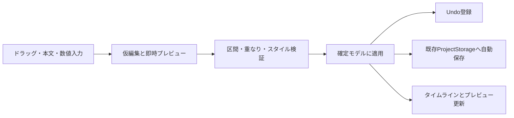

# 歌詞テロップ用タイムライン設計

画像配置の実装仕様は [画像レイヤーと配置モードの設計](IMAGE_TIMELINE.md) を参照。「歌詞」「画像・演出」タブ、画像最大3レイヤー、歌詞ゴースト、画像ドロップと画像管理（削除/置換/欠損復旧）を実装済み。この範囲は同設計を優先する。

作成: 2026-11-08。歌詞一覧・開始/終了秒の編集、共通文字描画、全歌詞共通のフォント・サイズ・描画位置・縁取り、プロジェクトの自動保存を実装済み。再生位置付近を拡大する独立タイムラインと本体移動/左右端トリムを実装済み。Undo/Redoは共通EditHistoryで実装済み。tick時間モデルは未実装。本文/時刻は変更時に自動反映・保存する。適用ボタンは設けない。日本語変換中と無効な区間は確定を保留する。連結追加・前テロップの末尾への追従も実装済みで、連結列は各表示時間を保って移動する。以下は目標設計。今回の確定要件は「タイムラインの最初の用途として、歌詞テロップ用の文字を並べること」。以下の操作・初期値・制約は実装提案。

## 1. 最初に作る機能

1本の歌詞トラックに、開始・終了時刻と文字列を持つテキストクリップを並べる。音声を聴きながら配置・調整し、既存のプレビューとMP4の両方へ表示する。音声を作品全体の時間基準とする。

初期版は1クリップ＝1フレーズ。同時に表示する歌詞は最大1クリップとし、クリップ内の改行は許可する。単語単位の色変化、カラオケ、ルビ、自動文字起こし、LRC/SRT入出力、複数歌詞トラック、クリップ分割、拍連動の文字アニメーションは次段階。音声・背景画像・スペクトラムの既存機能は継続する。

## 2. 画面と制作フロー

左上に映像プレビューと共通設定、右上に歌詞の追加・削除、一覧、本文、開始/終了、連結、フォント、サイズ、描画位置、縁取り設定を配置する。下段全幅に再生操作、全曲シークバー、表示範囲、時間目盛り、歌詞トラックを表示する。「歌詞」「画像・演出」の切替は右上に置く。

- 音声を読み込み、歌詞を出す時刻へシークする。
- 「＋歌詞」で再生ヘッド位置からクリップを追加し、本文欄へフォーカスする。
- 本文を入力し、プレビューで確認する。
- クリップを左右に動かして開始位置、左右端を引いて表示区間を調整する。数値入力でも同じ編集ができる。
- 次の時刻へ移動して追加を繰り返す。変更は既存プロジェクトへ自動保存する。

再生ヘッドとクリップ選択は独立。クリップのクリックは選択だけとし、目盛りや空白部分のクリックはシークする。編集を始めると再生を一時停止する。再生中の単純な選択では停止しない。

## 3. 時間と配置ルール

編集時刻の単位はInt64のtick、1秒＝48,000tickとする。30fpsでは1フレーム＝1,600tick。将来のfpsを考慮して評価器では整数時刻とフレーム時刻の有理数を比較し、非整数tickのフレームを累積丸めしない。既存の音声秒数からは境界で一度だけ変換する。

| 項目 | 初期仕様の提案 |
| --- | --- |
| 表示区間 | `[start, end)`。終了と次の開始が同じなら二重表示しない |
| 長さ | 最小1出力フレーム。既存固定30fpsで1,600tick |
| 追加時の長さ | 2秒。ただし次クリップ開始または音声末尾までに制限 |
| 追加可能位置 | 再生ヘッドが既存クリップ内ならその連結列末尾へ接続して追加。空白なら再生ヘッドから独立配置。十分な空き区間がなければ追加せず理由を表示 |
| 重なり | 同じ歌詞トラック内では禁止。間隔を空けることは許可 |
| 移動 | 長さを維持し、直前/直後クリップと曲の境界で制限。連結した後続のみ長さを保って追従させる。独立クリップは動かさない |
| トリム | 選んだ端だけを動かし、最小長・隣接区間・曲の境界で制限 |
| 数値入力 | 不正な区間や重なりは確定せず、入力欄に理由を表示。暗黙に隣のクリップを変更しない |
| 曲末 | クリップのendは作品長以下。末尾の余りが最小長未満なら追加不可 |

ドラッグ開始時に前後の隣接クリップから許容範囲を固定する。移動で他クリップを飛び越える動作は初期版では行わない。並べ替えは削除・再追加または将来の専用操作で対応する。

スナップは常時有効。選択した音符（全音符・2分・4分・8分・16分）と拍開始位置を基準に、新規作成・ドラッグ・時刻入力を最近傍へ揃える。フレーム単位への再丸めはしない。ドラッグでは許容区間内のグリッド点を選び、存在しなければ変更しない。本体移動は開始を揃えて長さを保持し、端トリムは対象端だけを揃える。連結追加は直前の終了を開始として維持し、新規終了をスナップする。既存の非グリッド区間の連結と長さは維持する。

歌詞の確定時刻は絶対時刻で保存する。BPM・拍開始位置を変えても歌詞を勝手に移動せず、拍線だけを更新する。

## 4. データモデル

既存のProjectFileへtimelineを追加する。概念型は次のように分ける。

| 型 | 保存する内容 |
| --- | --- |
| Timeline | tracksの順序付き配列 |
| TimelineTrack | UUID、名前、content。初期contentはlyrics(LyricsTrack)のみ |
| LyricsTrack | style、start順のclips |
| TextClip | UUID、startTick、durationTick、text（プレーンテキスト）、predecessorID（連結先、省略可） |
| LyricsTypography | フォントのPostScript名、1080p基準のサイズとX/Y |
| NormalizedRect | 0〜1のx/y/width/height。キャンバス左下基準 |
| TimelineEditorState | 選択ID、再生ヘッド、横スクロール、ズーム、ドラッグ中の仮値。保存しない |

Swift実装ではTextClip等をCodable/Sendable/Equatableの値型にする。endはstart＋durationから計算し二重保持しない。tickの加算オーバーフロー、ID重複、非正長、順序/重なり、不正なスタイル値を読込・編集確定時に検証する。

モデルはtracksを持つが、初期UIは歌詞1トラック固定。未実装の画像・音声クリップのenum caseや汎用プラグイン構造は作らない。将来、画像・ビジュアライザー用contentを追加する。歌詞では重複禁止、画像では重複許可といった制約はトラック種別が持つ。

文字スタイルは全クリップ共通。初期値はヒラギノ角ゴ W6・54px・X960・Y540・白文字＋黒縁。サイズは8〜216px、X/Yは映像左上を原点とする1080p基準の整数pxで、Xは中央揃えの軸、Yはテキスト枠の上端を表す。フォント名をPostScript名で保存し、利用できない場合は初期フォントで描画し、選択欄に未インストールと表示する。書式の記録がないプロジェクトには初期値を適用する。

## 5. 編集処理・Undo・自動保存

AppDelegateへタイムライン操作を積み増さず、MainActorのTimelineEditorを導入する。データ、選択、編集中の仮状態を所有し、AddTextClip / UpdateText / MoveClip / TrimClip / DeleteClip / UpdateStyleを実行する。

操作は次の流れで統一する。

ドラッグ中は仮モデルだけ更新し、mouseUpで1操作として確定する。Escapeでは元へ戻す。本文・時刻は有効な内容になるたびに自動反映し、本文ではEnterで改行する。日本語IMEの変換確定を歌詞編集の確定と混同せず、marked text中のEnterはIMEへ渡す。ボタン移動・書出し・終了前にも未確定編集を確定する。無効な時刻入力が残る場合はその操作を止め、修正箇所を示す。

EditHistoryに歌詞・画像・共通設定の値スナップショットを保存し、ドラッグ1回、本文/時刻の編集セッション1回、スライダーのマウス操作1回をそれぞれ1操作にする。入力中も⌘Z/⇧⌘Zは共通履歴に送り、IME変換中は実行しない。音声/プロジェクト読込成功時に履歴をリセットする。Undo/Redoも確定モデルの変更として自動保存する。全文削除も反映できるよう空文字クリップを許可し、その区間には文字を描かない。選択解除・スクロール・再生ヘッド移動だけでは保存しない。Delete/Space/矢印キーはタイムラインにフォーカスがある場合だけ解釈し、本文編集中の通常キー入力を奪わない。

自動保存先と起動時復元は現行の `<音声ファイル名>.mvproject` を維持する。schemaはversion 2へ更新し、timeline必須とする。開発中の方針に従いversion 1の移行処理は追加せず、古いファイルは明示エラーとして上書きしない。UIに「新規作成」を用意し、旧プロジェクトを別名バックアップとして残せた場合だけ新形式を作成する。未読込ファイルの黙示的な削除・初期化はしない。

保存失敗時も確定編集とUndo履歴はメモリに保持し、未保存状態・エラー・再試行を表示する。次の確定操作でも保存を再試行。最後に保存できたURLだけを次回起動用に記録する。

別音声へ切り替える場合は現在の仮編集を確定・保存し、読み込む側にプロジェクトがあれば復元、なければ空の歌詞トラックで開始する。他の曲の歌詞を引き継がない。

## 6. タイムラインの描画と入力

TimelineViewControllerの下に、固定トラック見出しとNSScrollView内のTimelineCanvasViewを配置する。カスタムNSViewで時間目盛り・拍線・クリップをまとめて描く。各クリップに独立したNSViewは作らない。インスペクターの本文はNSTextView、時刻は入力欄を使い、数値編集だけでも全クリップを操作できるようにする。

時間と画面位置の変換はTimelineGeometryへ集約する。

- `x = gutter + seconds(tick) × pointsPerSecond`
- マウス位置はview座標へ変換し、逆変換してtickを得る。
- スクロールによる座標差を入力・描画で重複加算しない。
- 拡大/縮小は再生ヘッド位置を画面上で維持する。初期は曲全体を表示し、任意倍率へ変更可能。
- 可視区間のクリップだけを描く。開始順配列に二分探索を使い、初期版で区間木は導入しない。
- 端ハンドルは画面上6pt。短いクリップでは端操作を誤認しやすいため数値編集を併用する。
- 再生ヘッドは共通Transportの現在時刻から描画。タイムライン専用タイマーで別の時刻を進めない。

既存シークスライダーとタイムラインは同じseek処理を呼ぶ。全曲用シークスライダーを残し、再生位置付近を拡大するタイムラインを別に配置する。初期版ではドラッグ中の自動スクロールは実装せず、表示範囲内で編集する。

波形を追加する際はAudioAnalyzerでPCM読込中にチャンネルごとのmin/maxを集計し、表示用の階層データを生成する。スペクトラムの帯域データを波形として代用しない。

## 7. プレビューと出力への反映

LyricsEvaluatorはタイムラインと時刻から現在有効なテキスト1件を返す。UIの選択や再生履歴に依存させない。開始位置を二分探索し、終了時刻も判定する。空白区間と曲末では歌詞なし。

SceneRendererは背景画像→スペクトラム→歌詞の順に合成する。現行のスペクトラムOFF時の早期returnを除き、各要素を独立して描く。画像への拡大パルスを歌詞には適用しない。

文字はCore Textでレイアウトし、共通CGContextへ描く。テキスト枠は映像幅の84%で、指定したYから映像の下端まで使う。枠内で日本語の折返し・改行を扱い、映像の境界で描画を切り取る。背景描画後に文字レイアウトの座標系・textMatrixを明示して上下反転を防ぐ。

プレビューと出力は共通のLyricsRendererを使う。各描画でLyricsTrackから有効な本文と書式を取得し、Core Textのレイアウトを作成する。

VideoExporterは開始時のtimelineとstyleをsnapshotとして受け取る。最終MP4まで同じsnapshotを使い、編集中のUIを読まない。出力中の編集禁止は現行仕様を維持する。30fpsでは表示開始はstart以上になる最初のフレーム、終了はend以上になる最初のフレームで消える。

## 8. 変更するファイルと実装順序

| 順序 | 追加・変更 | 完了条件 |
| --- | --- | --- |
| 1 | Timeline.swift / TimelineEditing.swift / ProjectFile.swift | モデル、時刻、区間検証、コマンド、保存往復。version 2の失敗時保護を確認 |
| 2 | LyricsRenderer.swift / Scene.swift / VideoExporter.swift | 固定テキストを指定区間だけプレビューとMP4へ同じ位置・サイズで表示 |
| 3 | TimelineViewController.swift / TimelineCanvasView.swift / App.swift | 追加、選択、本文/数値編集、削除、共通シーク。既存描画・再生と接続 |
| 4 | TimelineGeometry.swift / TimelineEditor.swift | 移動、端トリム、ズーム、スナップ、Undo/Redo、操作単位の自動保存 |
| 5 | AudioAnalyzer.swift / TimelineCanvasView.swift | 音声波形、長い曲の可視範囲描画の確認 |

各段階の後に責務・重複・命名を見直して検証する。まず文字を動画へ出せる経路を成立させ、複雑なドラッグUIをその後につなぐ。

## 9. 検証と受け入れ条件

- 時間: 開始/終了の直前・一致・直後、隣接クリップ、空白、曲末で表示が正しい。
- 編集: 曲頭/曲末、最小長、衝突、拍開始位置が0でない場合、スナップON/OFF、複数倍率で同じ確定時刻。
- 再生: 順再生と任意順シークで同じ歌詞。BPM変更で歌詞位置が変わらない。
- 文字: 日本語、英語、絵文字、明示改行、長文、未導入フォント。上下反転、欠字、枠超過を確認。
- 保存: 追加・移動・本文・スタイル変更・削除・Undo/Redo後に再読込し一致。保存失敗から再試行し、壊れたファイルは上書きしない。
- UI: ドラッグ取消、本文の日本語IME、未確定入力のまま終了/音声切替/書出し。キー操作が本文入力と競合しない。
- 出力: 既知時刻に異なる歌詞を配置した短い動画を再読込し、境界前後の文字と位置を検証。スペクトラムOFFでも歌詞を表示。

最初の受け入れシナリオは「1曲に3つの歌詞を置く→移動/長さ変更→音楽と確認→アプリ再起動で復元→同じ歌詞入りMP4を出力」。性能確認は5分曲・300クリップを基準ケースとし、実測後に最適化する。

## 10. 参考

- [Core Text公式資料](https://developer.apple.com/documentation/CoreText): 文字組版、CGContextへの描画、レイアウトオブジェクトのスレッド利用制約。
- [全体設計](ARCHITECTURE.md): 音声解析・再生・描画・書出しの構成。

現行コードの制約（ProjectFile version 1、SceneRendererの早期return、音声切替時の状態管理）を確認した上での設計。一覧編集と縁取りのコード実装・描画/保存/動画出力のテストは実施済み。拡大タイムラインのドラッグ操作はAppKitイベントでプレビュー/確定/取消を検証済み。

## 現行の連結編集

実装のLyricClipは秒単位のstart/endと、省略可能なpredecessorIDを持つ。連結先は時間順の直前クリップに限定し、ID重複・不正参照・境界不一致は検証で拒否する。先頭の開始変更は長さ維持の移動、終了変更は長さ変更とし、連結列全体を再計算して検証後に一括反映・保存する。連結中の開始位置を直接変えると独立に切り替える。削除時は直後の連結を解除して絶対位置を維持する。

## 現行の拡大タイムライン

PlacementEditorの共通TimelineViewは再生位置の周辺2〜300秒を表示する。表示範囲はTimelineDisplaySettingsでUserDefaultsに保存するアプリ共通設定。初期値12秒、起動時復元、スライダーまたは⌘＋ホイールで変更すると保存する。タイムラインとオートメーションレーンで同じ横ズームを使う。ホイールでは直前の目標値に倍率を適用し、現在表示中の範囲から新しい目標へ0.2秒のcubic ease-outで補間する。保存は目標値の変更時だけ行う。プロジェクトを切り替えても維持する。TimelineGeometryが描画座標と秒の変換を担い、ドラッグ開始時に表示範囲とモデルを固定する。歌詞・画像クリップの左右端では、ホバー中のトリム領域を黄色で示す。LyricsTrack.draggingで本体移動/左端トリム/右端トリムを計算し、連結後続と独立区間の境界から移動可能範囲を制限する。ドラッグ中はプレビューのみ更新し、mouseUp時にcommit経路で確定・自動保存。Escとアプリ終了準備時には仮変更を取り消す。スナップ単位はTimelineDisplaySettingsで保存し、初期値は16分音符。Undo/Redoは実装済み。波形は未実装。

Shift＋ホイールでは歌詞・画像・オートメーションで共通の表示位置だけを移動し、曲頭と曲末で止める。再生位置や表示範囲の長さは変更せず、ドラッグ中は表示座標を固定する。スクロール位置は保存しない。再生開始・全曲シークバーの操作・音声切替・「曲全体」の選択で再生位置への追従に戻る。

Option＋ホイールは既存のシーク処理を使う。ホイール1目盛りで表示中の時間幅の1/60だけ移動し、上で曲頭方向、下で曲末方向へ進む。曲の範囲内に制限し、手動スクロール後に移動先が画面外なら表示を再生位置に追従させる。

表示範囲は固定2〜300秒または「曲全体」を選択可能。「曲全体」は5分を超える曲にも対応し、曲切替時も曲長に追従する。固定範囲と切替状態をUserDefaultsへ保存し、表示幅に合わせて目盛り間隔を調整する。曲全体から⌘＋ホイールで拡大すると、拡大可能な場合に固定範囲へ切り替える。
